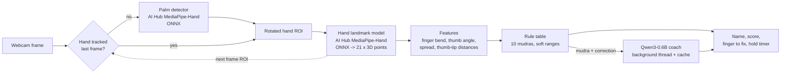

# MudraGuru

**An offline webcam tutor for Bharatanatyam hasta mudras.** Hold up your hand; MudraGuru finds it, reads
21 landmarks, tells you which mudra you are holding and how well, points at the finger to fix, and a
small on-device language model says it the way a teacher would. Nothing leaves the laptop.

## The problem

Hasta mudras are the vocabulary of Bharatanatyam: each hand shape carries meaning, and small errors (a ring
finger not quite folded, a thumb held out instead of tucked) change or blur it. Students practise alone
between classes with no one to correct them, and a teacher's attention in class is split across many students.
MudraGuru gives instant, specific, private feedback -- which finger, which way -- and works without internet,
so it runs in a classroom, at home or on a stage-side laptop.

## How it works



- **Execution providers.** The two hand models run through ONNX Runtime with a selectable execution provider:
  `qnn` (Hexagon NPU on Snapdragon, via onnxruntime-qnn), `dml` (DirectML, any DirectX 12 GPU) or `cpu`.
  `--ep auto` picks the best available. The MediaPipe pip package stays as a fallback backend.
- **Tracking.** As in MediaPipe, the palm detector only runs when no hand is being tracked. After that, each
  frame's hand box comes from the previous frame's landmarks, which halves the per-frame cost.
- **Mudra rules** (`mudraguru/mudras.py`). Each mudra is a data table of target ranges on rotation-, scale- and
  mirror-invariant features. Each range gives a soft match, and the score is their weighted geometric mean,
  so one clearly wrong finger pulls the score down. The worst-matching range becomes the correction
  ("Bend your ring finger") and its finger is drawn in red. Tuning means editing numbers, not retraining.
- **Coach** (`mudraguru/coach.py`). Qwen3-0.6B, prompted with a few examples, rewrites the correction as one
  warm sentence ("Let your scissors rise: spread index and middle fingers wide."). It runs on its own thread,
  so the video never waits. Results are cached per (mudra, correction) pair, and the cache is pre-filled
  in the background.
- **Practice mode** (`mudraguru/practice.py`). You get a target mudra and hold it above 70% for 2 s to pass.
  Every attempt is logged to `logs/practice_log.csv`, and your pass rate per mudra is shown on screen.

Mudras recognised: Pataka, Tripataka, Ardhapataka, Kartarimukha, Mayura, Ardhachandra, Alapadma, Mushti,
Shikhara, Hamsasya.

## Models and licences

| Component | Model | Source | Licence |
|---|---|---|---|
| Palm detector | MediaPipe-Hand-Detection `hand_detector` (1.76 M params) | [Qualcomm AI Hub](https://aihub.qualcomm.com/models/mediapipe_hand), weights from [MediaPipePyTorch](https://github.com/zmurez/MediaPipePyTorch) | Apache-2.0 |
| Hand landmarks | MediaPipe-Hand-Detection `hand_landmark_detector` (2.01 M params) | same | Apache-2.0 |
| Coach | Qwen3-0.6B | [Qwen/Qwen3-0.6B](https://huggingface.co/Qwen/Qwen3-0.6B) | Apache-2.0 |
| Fallback tracker | MediaPipe Hands (pip `mediapipe`) | Google | Apache-2.0 |
| Pre/post-processing | adapted from `qai_hub_models` mediapipe app | Qualcomm | BSD-3-Clause |

`models/*.onnx` are exported locally by `tools/export_hand_onnx.py`, from the `qai_hub_models` PyTorch modules
with `torch.onnx.export`, so no AI Hub token is needed. The Qwen weights (1.5 GB) are downloaded by
`tools/download_coach_model.py` and are not committed.

## Setup (Windows x64)

```
py -3.11 -m venv .venv
.venv\Scripts\python -m pip install -r requirements.txt
# optional coaching line (~1.7 GB with the model):
.venv\Scripts\python -m pip install -r requirements-coach.txt --extra-index-url https://download.pytorch.org/whl/cpu
.venv\Scripts\python tools\download_coach_model.py
.venv\Scripts\python app.py
```

**On Snapdragon (Windows on ARM):** use ARM64 Python and `pip install numpy opencv-python onnxruntime-qnn`,
then run `python app.py --ep qnn`. The FPS overlay shows `onnx:QNN` when the NPU is in use. `mediapipe` has
no ARM64 wheel, and the app does not need it. The coach needs a Windows ARM64 build of PyTorch; if you don't
have one, add `--no-coach`.

**Re-exporting the hand models** (only if `models/` is missing): create a second venv, run
`pip install qai-hub-models`, then `set QAIHM_CI=1` (this skips the interactive "OK to clone?" prompt)
and `python tools\export_hand_onnx.py`.

## Controls

| Key | Action |
|---|---|
| M | switch detect / practice mode |
| N / P | next / previous target mudra (practice) |
| D | show the raw feature values (for tuning the rule table) |
| C | save the current features, labelled, to `logs/feature_samples.csv` |
| Q / Esc | quit |

Useful flags: `--ep auto|qnn|dml|cpu`, `--backend onnx|mediapipe`, `--mode practice`, `--hold 3`,
`--threshold 0.6`, `--no-coach`, `--camera 1`, `--no-mirror`.

## Benchmark

`python benchmark.py` times every stage on each available execution provider and writes
[`bench/results.md`](bench/results.md). Results from a Lenovo IdeaPad Slim 5 (AMD Ryzen AI 7 350, Radeon 860M),
median ms per 1280x720 frame:

| Backend | Execution provider | Mode | Detector | Landmark | Pre/post | Rules | Total | FPS |
|---|---|---|---:|---:|---:|---:|---:|---:|
| AI Hub ONNX | DirectML (Radeon 860M) | tracking | - | 6.47 | 0.30 | 0.57 | 7.39 | 135 |
| AI Hub ONNX | DirectML (Radeon 860M) | detect every frame | 7.16 | 5.78 | 0.31 | 0.51 | 13.79 | 71 |
| AI Hub ONNX | CPU | tracking | - | 9.03 | 0.39 | 0.48 | 9.82 | 88 |
| AI Hub ONNX | CPU | detect every frame | 11.51 | 9.35 | 0.35 | 0.45 | 21.56 | 35 |
| MediaPipe pip | CPU (TFLite) | built-in tracking | - | - | - | 0.60 | 18.32 | 54 |

Coaching line: about 4.6 s per new sentence on the CPU, on a background thread and cached, so it never
slows the video.

**Snapdragon NPU reference.** For these exact models, Qualcomm AI Hub publishes 0.861 ms (detector) and
1.106 ms (landmark) on the Snapdragon X Elite, and 0.475 ms / 0.685 ms on the X2 Elite (ONNX Runtime + QNN on
the Hexagon NPU). That is roughly 6x less model time than DirectML on this laptop, and it leaves the CPU and
GPU free.
To measure it yourself, run `python benchmark.py --eps qnn cpu --no-mediapipe` on a Snapdragon laptop, or
`python tools/aihub_profile.py` against AI Hub cloud devices (needs an AI Hub API token); details are in
`bench/results.md`.

## Tests

```
.venv\Scripts\python -m tests.test_mudras     # synthetic hands: every mudra recognised, corrections name the right finger
.venv\Scripts\python -m tests.test_onnx_hand  # AI Hub ONNX landmarks match MediaPipe within 5 px on a real photo
```

## Project layout

```
app.py                  webcam UI (detect + practice modes)
benchmark.py            per-stage latency per execution provider -> bench/results.md
mudraguru/onnx_hand.py  AI Hub MediaPipe-Hand via ONNX Runtime (QNN / DirectML / CPU)
mudraguru/tracker.py    backend switch (onnx | mediapipe)
mudraguru/features.py   landmark -> invariant features
mudraguru/mudras.py     the rule table + scorer
mudraguru/coach.py      Qwen3 coaching line (background thread, cache)
mudraguru/practice.py   practice sessions + CSV log
tools/                  model export / download, AI Hub profiling
tests/                  synthetic-hand and real-photo tests
```
